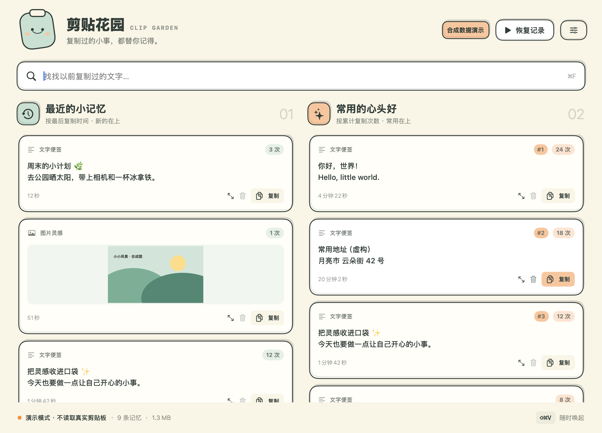

# 剪贴花园 1.0

一个只在本机工作的 macOS 剪贴板小花园。奶油色卡通界面，左右两列同时浏览：**最近复制**按最后复制时间倒序，**常用内容**按累计外部复制次数倒序。

## 界面预览



所有截图仅包含合成文字与自绘图片；更多截图见 [docs/screenshots](docs/screenshots)。

## 安装与开始

适用于 **Apple Silicon（M1/M2/M3/M4 及后续芯片）、macOS 14 或更高版本**。本次在 arm64 Mac、Swift 6.4 / macOS SDK 26.5 上编译并测试。

本仓库发布源码、构建脚本、图标和合成截图，未发布 Release 二进制，也未配置 GitHub Actions。先运行下方构建命令生成应用。

1. 将本地构建的 `build/剪贴花园.app` 拖到「应用程序」或你选择的目录。
2. 打开应用，阅读首次隐私提示；点击「同意并开启记录」后，才开始保存下一次复制的内容。不会导入打开前的系统剪贴板。选择「暂不开启」可先看看界面。
3. 菜单栏的小叶子可以打开窗口、暂停/恢复记录、进入设置和退出。关闭窗口后仍留在菜单栏运行。
4. 默认全局唤起快捷键是 **⇧⌘V**。设置中点击组合键按钮，按下新组合即可保存；Esc 取消录制。至少包含 ⌘、⌥ 或 ⌃。

本地构建只带 **本地 ad-hoc 签名**，没有 Developer ID 签名或 Apple 公证。macOS 可能拦截首次打开；请根据系统正常的「隐私与安全性」提示自行决定是否允许。没有移除隔离标记、关闭 Gatekeeper、修改安全设置或申请辅助功能/录屏权限的脚本。若组织策略要求已公证软件，需要开发者账号重新签名公证。

## 使用

- 搜索框同时筛选两列，⌘F 聚焦搜索。按原文包含关系搜索（中文/Unicode 内容支持；英文 ASCII 不区分大小写），不使用通配符。
- 点击卡片内容或「复制」把内容放回剪贴板，再自行粘贴。应用不会自动往其他软件注入内容。
- 放大按钮查看全文/完整图片和首次、最后时间；垃圾桶删除单条。
- 每列先显示 60 条，可以点「再看看更早的记忆」继续；所有历史可搜索。
- 设置中可查看磁盘占用、打开数据文件夹、清空全部历史（需二次确认）。
- 同内容按 SHA-256 去重，精确保留文本空格、换行与 Unicode。再次从外部复制同内容会更新最后时间、累计次数。应用自己「复制」历史不增加次数、不制造循环。

## 支持范围与边界

**支持：** 纯文本、剪贴板 PNG/TIFF 图片（内部规范化为 PNG）；图片有缩略图与完整预览。单条文字最多 2 MiB，图片最多 20 MiB、3000 万像素，单边最多 12000 像素。超限会跳过。

**不支持：** 文件/文件夹、富文本样式、HTML 格式、音视频、图片 OCR；带文件 URL 的剪贴板整体跳过。图片按规范化后的 PNG 字节去重，不保证不同编码或色彩元数据的视觉相同图片合并。多个项目只提取一个文本或图片记录。

剪贴板每约 **0.45 秒**检查一次 changeCount，只读取有变化的内容。不把 changeCount 的跳变直接当作复制次数（一次复制可能产生多个变化）。一般外部重复复制会正确累计；极短时间内连续复制、应用阻塞或休眠期间的中间内容无法保证捕获。暂停后恢复会从新的 changeCount 开始，不补采暂停期间的内容。

快捷键通过系统 Carbon 注册；检测注册失败并保留原快捷键，拒绝部分常见系统保留/编辑组合。**无法枚举或保证检测所有第三方快捷键冲突**。即使注册成功，仍可能被特定软件拦截或在系统「安全键盘输入」期间无法使用；可用菜单栏打开。没有辅助功能权限要求。

## 隐私、保留与磁盘

- 不包含网络客户端、不联网、不上传剪贴板。没有自动登录启动项。
- 仅在首次明确开启后采集；关闭窗口不会停止记录，请使用「暂停记录」或退出。
- 跳过带 `org.nspasteboard.TransientType`、`ConcealedType`、`AutoGeneratedType`、已知 1Password 标记，以及类型名含 password/concealed 的剪贴板。**不是所有密码管理器都给标记，普通文本中的密码、验证码、密钥无法可靠自动识别。敏感操作前请暂停。**
- 数据库在 `~/Library/Application Support/ClipGarden/history.sqlite3`；快捷键与开启状态在应用的 macOS 偏好设置中。
- SQLite 数据库采用事务、WAL 和 owner-only 文件权限。**数据库没有额外加密**；同一账户及系统备份可能访问。可配合 macOS FileVault；应用不会自行修改系统设置。
- 不自动过期或限条数；长期历史会增长。重复内容只增加计数，不重复保存内容。图片一般比文字占用更多；底部显示数据库/WAL/SHM 的实际总大小，缩略图也计入。
- 删除和清空会执行 SQLite secure_delete、checkpoint 与 VACUUM 回收空间，但不能保证抹除 APFS 快照、系统备份或 SSD 内部旧块。清空历史不清空系统当前剪贴板。
- 卸载应用不会自动删除历史；如需删除，先在设置中清空，退出后移除上述数据目录。

## 源码与复现

零第三方依赖。SwiftUI / AppKit / Carbon / CryptoKit / SQLite；无需完整 Xcode，只需兼容的 Apple Command Line Tools。

```sh
./scripts/build.sh
./scripts/test.sh
```

构建产物：`build/剪贴花园.app`。本构建脚本输出 arm64；不包含 Intel 版本，macOS 14 上未做实机测试。

只看合成数据的独立演示，不读取真实剪贴板、不接入正式数据库：

```sh
build/剪贴花园.app/Contents/MacOS/ClipGarden --demo
```

合成截图（仅捕获应用视图，不截取其他窗口/桌面，不需要录屏权限）：

```sh
build/剪贴花园.app/Contents/MacOS/ClipGarden --demo --screenshot "$PWD/Deliverables/主界面.png"
```

`--self-test` 使用随机临时数据库与独立命名 NSPasteboard，绝不读写系统 general 剪贴板。`--demo` 的复制按钮也只写入隔离测试剪贴板。正常使用请从 Finder 打开应用。

## 验证记录

1.0 版本已通过实际编译、48 项隔离合成测试，以及双列搜索、复制、完整预览、快捷键录制与冲突提示、清空确认的原生界面检查。自动测试源码见 `Sources/SyntheticTests.swift`；测试不会读写真实 general 剪贴板。

本仓库没有包含历史数据库、凭据、构建产物或本机日志，也没有添加开源许可证。
